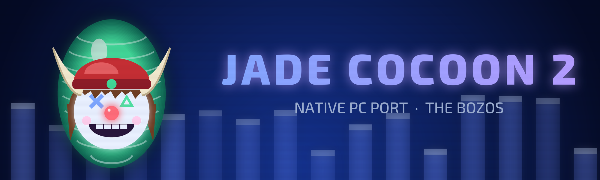
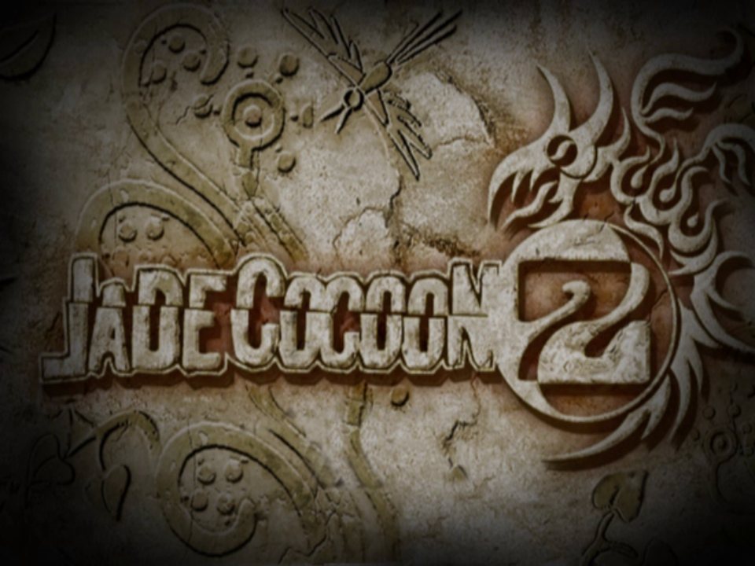
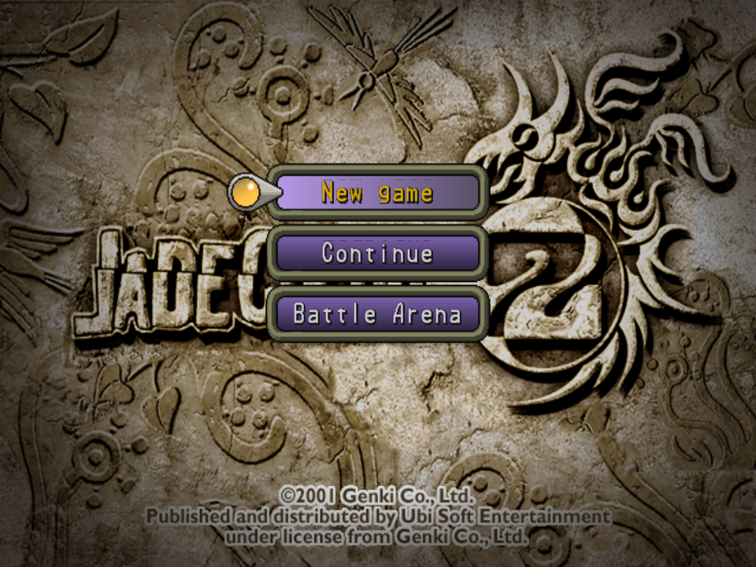

<div align="center">



# JC2_Recomp

**A native Windows and Linux port of *Jade Cocoon 2* (NTSC-U, `SLUS-20309`), made by statically recompiling the game's PlayStation 2 code to C++.**<br>
Not an emulator: the game's own MIPS R5900 code, rebuilt as a native program on [BozoEngine](https://github.com/TheBozos/BozoEngine), with no PS2 hardware at any level.


</div>

> [!IMPORTANT]
> No game files are included: no ELF, IRX modules, data archives, or code generated from them.
> You need **your own copy** of the North American release, PS2 ID **`SLUS-20309`**. The port is built against that disc's executable:
>
> | File | SHA-1 |
> |---|---|
> | `SLUS_203.09` | `fa778a8dcb5a16e8146976fe4ab444856f04c47b` |

## Status

**Bring-up, not playable yet.** The port builds on [BozoEngine](https://github.com/TheBozos/BozoEngine), The Bozos' own
toolchain: the game's calls are answered by native libraries and JC2's own port code, with no GIF packet, no GS state
machine and no IOP in between. The intro movie (with its music), the title, the main menu, the first in-game scenes,
the forests and the battles are drawn natively from the game's own data; the rest is being ported, one draw family at
a time. Windows comes first, then Linux.

| Milestone | |
|---|:---:|
| Main ELF recompiled offline from the player's disc at build time | ✅ |
| Code overlays: the 1,383 CodeWarrior modules loaded at run time, each compiled as an image of its own | ✅ |
| Sound driver (the game's own IOP modules) compiled offline to native C++ over host services | ✅ |
| Movies, title screen, main menu | ✅ |
| New game: opening movie, first scenes and dialogue, the Jade Throne Room, the forests | ✅ |
| Battles drawn (stage, monsters, effects) | ✅ |
| Animated IPU textures decoded natively (D001's water) | ✅ |
| Forest and town effects (VU1 program D: water, fireflies, dust, motes; program E: the Fire Forest's heat haze) | 🔧 |
| Debug teleport (`--scene`, field scenes), battle launcher (`--battle`, `--battle-group`), story state (`--chapter`, `--subarea`...) | ✅ |
| Memory card saves | ⏳ |
| Linux build | ⏳ |
| Widescreen, higher internal resolution | ⏳ |

✅ works · 🔧 in progress · ⏳ not reached yet

[docs/RECOMP_NOTES.md](docs/RECOMP_NOTES.md) records how the port is brought up, every fix and how it was found, and
what remains open.

## Screenshots

The intro movie, the title and the main menu, drawn natively:

| | |
|---|---|
|  |  |

The first in-game scenes, from an earlier build, up to the Wormhole Forest:

| | | |
|---|---|---|
|  |  |  |
|  |  | |


## Goal

A fully playable *Jade Cocoon 2* as a native executable on Windows and Linux, from the intro to the end of the story.
Accuracy first; once it is playable, widescreen and higher internal resolution.

## How it works

```
disc files (game/) ──► tools/jc2_bozo_prepare.py (code spans, entry points; recomp/ghidra/jc2_functions.csv)
                   ──► bozo-recomp ──► the main ELF as C++ (build/bozo_game/jc2_gen)
   CDDATA.000 overlays ──► tools/jc2_bozo_overlays.py ──► bozo-recomp per module (1,383 modules)
   the game's sound IRX ──► tools/jc2_bozo_audio.py ──► BozoEngine's native_irx ──► native C++
   3D models ──► tools/jc2_mesh_pack.py ──► BozoEngine mesh pack
                                           │
             CMakeLists.txt ──► BozoEngine + generated code + runtime/jc2_*.cpp ──► jc2 (window), jc2-headless
```

- The retail executable is stripped, and its code and data share a single segment. `recomp/ghidra/jc2_functions.csv`
  is the function map (Ghidra with the Emotion Engine extension, entries on data dropped by
  `tools/filter_ghidra_map.py`); `recomp/jc2_symbols.txt` names the functions BozoEngine's libraries answer.
- Everything derived from the disc is produced at build time into `build/`, never committed.
- `runtime/` holds JC2's port code: draws from the game's own data, the scene and battle debug tools, save states.

## Requirements

- Windows 10/11 with [MSYS2](https://www.msys2.org/) (UCRT64, see below) or Linux
- CMake 3.21+, Ninja, GCC 13+ or Clang with C++20
- FFmpeg development libraries (`libavcodec`, `libavformat`, `libavutil`, `libswresample`, `libswscale`) and `pkg-config`
- `bsdtar` (libarchive) to extract the disc, Python 3
- A CPU with AVX2
- Your own copy of `SLUS-20309` (check the hash above)

## Build and run

```bash
git clone --recurse-submodules https://github.com/TheBozos/JC2_Recomp.git
cd JC2_Recomp
scripts/extract_iso.sh "/path/to/Jade Cocoon 2 (USA).iso"   # disc files -> game/
cmake -S . -B build/bozo_game -G Ninja -DJC2_WINDOW=ON
cmake --build build/bozo_game -j 4
build/bozo_game/jc2                                          # the game window
build/bozo_game/jc2-headless --frames 600                    # no window (checks, scripted runs)
```

`--help` lists the options: save states (`--load-state`, `--save-state`), teleport (`--scene N`), the story (`--chapter`,
`--story-flag`, `--scene-done`, `--forest-stage`, `--subarea`), the battle launcher
(`--battle N`), hidden-window captures (`--hidden`, silent too) and `--mute`.

### Windows

Build in an MSYS2 **UCRT64** shell, with MSYS2's GCC (MSVC is not supported for this port).

```bash
pacman -S --needed mingw-w64-ucrt-x86_64-{gcc,cmake,ninja,pkgconf,ffmpeg,libarchive,python} git
```

## Disc facts

| | |
|---|---|
| Boot ELF | `SLUS_203.09`, entry `0x100008`, one segment at `0x100000` (6 MB of code and data), stripped |
| Code | `0x100000-0x4E3E80` and `0x6B2B00-0x6B9310` (static constructors, table at `0x6B9310`) |
| Overlays | ~1,390 zero-size LOAD segments at `0x940000`, filled at run time |
| Video mode | NTSC |
| IOP modules | `IRX/*.IRX`: ATAD, DEV9, HDD, PFS, IMODEDRV, IMODEMAN, M2IMODE, M2IOPSYS, M2SOUND, MODHSYN, MODMIDI, LIBSD, MCMAN, MCSERV, MTAPMAN, PADMAN, SIO2MAN, UAMAN |
| IOP image | `IRX/IOPRP23.IMG` |
| Data | `CDDATA.000` (1.3 GB archive) with its index `CDDATA.LOC`, `MOV/`, `VOICE/` |

## Sharing the machine with other ports

Several ports are developed on the same machine. A timed game run, benchmark or heavy build takes the shared bench
lock (BozoEngine's `tools/bench_lock.sh`, file `D:/ps2recomp_bench.lock`) first, so that another port's build or game
does not skew it:

```bash
scripts/bench_run.sh 5 "boot timing" build/bozo_game/jc2-headless --frames 600   # one slot
scripts/bench_run.sh --alone 60 "JC2 build" cmake --build build/bozo_game -j 4      # the bench alone
```

## Repository layout

| Path | Contents |
|---|---|
| `recomp/` | The Ghidra function map and the symbol names |
| `runtime/` | JC2's port code (draws, debug tools, save states, the game window's entry point) |
| `scripts/` | Disc extraction, the bench lock wrapper |
| `tools/` | Build-time converters (`jc2_bozo_*.py`, `jc2_mesh_pack.py`) and analysis helpers |
| `docs/` | Bring-up notes, branding |
| `BozoEngine/` | The engine (submodule) |

Everything derived from the game (`game/`, `generated/`, `build/`, disc images, captures) is git-ignored. Never commit or
redistribute it.

## Credits

- [BozoEngine](https://github.com/TheBozos/BozoEngine) by The Bozos, the engine this port is built on.
- The *Twisted Metal: Black*, *The Third Age*, *Valkyrie Profile 2: Silmeria* and *Drakengard* ports, developed on the same engine; fixes are shared.
- *Jade Cocoon 2* © Genki, published by Ubisoft in North America. This is an unofficial fan project, not affiliated with or endorsed by them.
